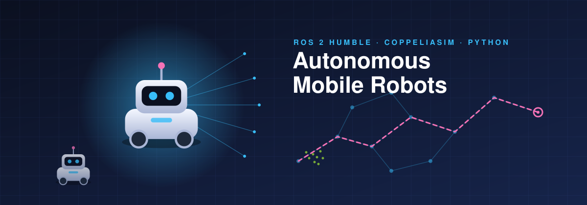
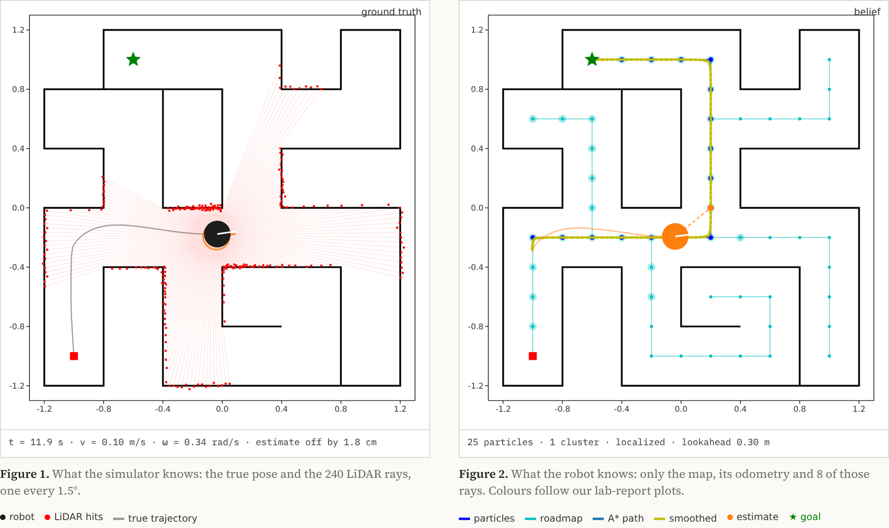
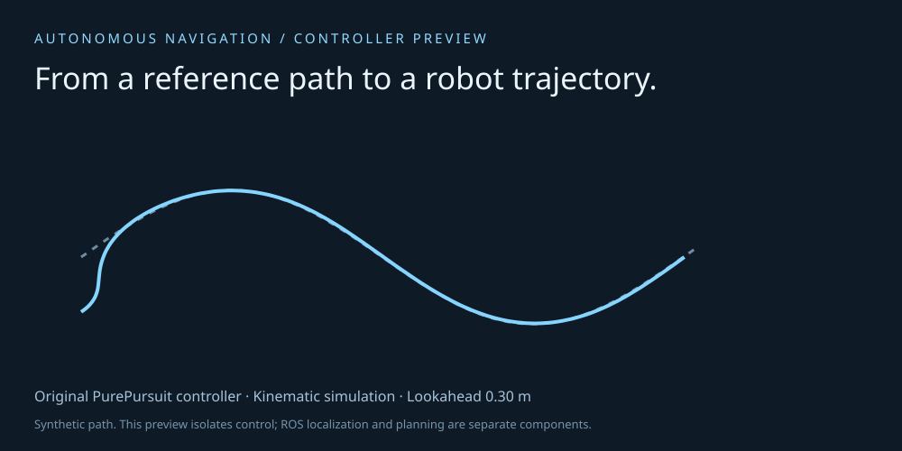
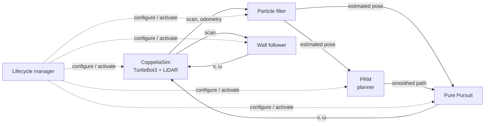

<div align="center">



# Autonomous Navigation on ROS 2

A TurtleBot3 that starts with no idea where it is, figures it out from LiDAR, plans a route and drives it. Particle filter, probabilistic roadmap and pure pursuit, all written by us on ROS 2.

**[Watch it run in your browser](https://liiiaamm.github.io/autonomous-navigation-ros2/)** · [Architecture](#architecture) · [Lab reports](#documentation)

**Development period:** January–May 2026


</div>

---

## Overview

This repository contains the labs and final project of the Autonomous Mobile Robots course (BSc in Mathematical Engineering and Artificial Intelligence, ICAI – Universidad Pontificia Comillas). It implements the complete navigation stack of a differential-drive robot, a TurtleBot3 Burger, in the CoppeliaSim simulator, with a parallel workspace for the physical robot.

| Layer | Technique | Package |
|-------|-----------|---------|
| Localization | Monte Carlo particle filter with LiDAR, supporting global and local localization | `amr_localization` |
| Planning | Probabilistic Roadmap (PRM) with grid sampling, obstacle inflation and path smoothing | `amr_planning` |
| Reactive control | State-machine wall follower | `amr_control` |
| Path tracking | Pure Pursuit with configurable lookahead distance | `amr_control` |
| Simulation | ROS 2 to CoppeliaSim bridge, scenes and robot model | `amr_simulation` |
| Orchestration | Launch files and node lifecycle manager | `amr_bringup` |

## Watch the whole stack in your browser

[](https://liiiaamm.github.io/autonomous-navigation-ros2/)

**[liiiaamm.github.io/autonomous-navigation-ros2](https://liiiaamm.github.io/autonomous-navigation-ros2/)**

Installing ROS 2 and CoppeliaSim takes an afternoon, so the four nodes are also ported to plain JavaScript in [`web/nav.js`](web/nav.js), with the parameters from `amr_bringup/launch/project.launch.py` and the map from `maps/project.json`:

| Node | Port |
|------|------|
| `wall_follower` | Same state machine (Front, Turn_Left, Turn_Right) and PD gains on the side distance |
| `particle_filter` | 1000 particles, 8 of the 240 rays, Gaussian likelihood with σ = 0.2 m, stratified resampling every 10 steps, DBSCAN (ε = 0.2) to decide when it is localized, then 25 particles |
| `probabilistic_roadmap` | 0.2 m grid, 0.15 m safety distance, 0.3 m connection distance, A*, gradient smoothing with 5 extra points per edge |
| `pure_pursuit` | 0.3 m lookahead, turn in place above π/3.5, speed scaled by heading error |

The page shows two plots side by side. The left one is ground truth: the true pose and every LiDAR ray. The right one is the robot’s belief: particles, roadmap, A* path and smoothed path, in the colours of our lab-report figures. Below them there is a live `rqt_graph`-style view of the node graph, where each message travels along its topic (`/scan`, `/odometry`, `/pose`, `/path`, `/cmd_vel`), and the node logs. Click either plot to move the goal. Try a long lookahead to see it cut corners into walls.

The JavaScript simulator stands in for CoppeliaSim with differential-drive kinematics, LiDAR and odometry noise, and walls the robot slides along on contact. It also shows a real failure mode: the maze is close to symmetric, so with some seeds the filter commits to the wrong corridor and “arrives” somewhere else. Only the ground-truth plot can tell.

## Try the controller without ROS



Installing ROS 2 and CoppeliaSim takes a while, so there is a small sandbox that runs our actual `PurePursuit` class in a kinematic simulation and plots the result in the browser:

```bash
pip install numpy
python demo/server.py          # then open http://127.0.0.1:8766
python demo/server.py --verify # checks four lookahead distances reach the goal
```

You can change the lookahead distance and watch the trade-off: short lookahead hugs the path but oscillates, long lookahead is smooth but cuts corners. The sandbox has no localization noise or obstacles; it isolates the controller.

## Architecture



All nodes are ROS 2 lifecycle nodes. The `lifecycle_manager` configures and activates them in a fixed order, with the simulator always last.

## Repository structure

```
|
├── sim_ws/                     # ROS 2 workspace (simulation)
│   ├── .devcontainer/          # Dev Container (ROS 2 Humble + xrdp desktop)
│   └── src/
│       ├── amr_bringup/        # Launch files (lab02, lab03, lab04, project) and lifecycle manager
│       ├── amr_control/        # Wall follower and Pure Pursuit
│       ├── amr_localization/   # Particle filter, maps and ray tracing
│       ├── amr_planning/       # Probabilistic Roadmap
│       ├── amr_simulation/     # CoppeliaSim node, robot and scenes (.ttt)
│       ├── amr_msgs/           # Custom messages
│       └── tutorial_pubsub_py/ # Publisher/subscriber tutorial
├── tb3_ws/                     # ROS 2 workspace (real TurtleBot3)
├── demo/                       # Browser sandbox for the pure-pursuit controller
├── docs/                       # Figures
└── final_reports/              # Lab reports (P1-P4)
```

## Getting started

### Requirements

- [Docker](https://www.docker.com/) and [Visual Studio Code](https://code.visualstudio.com/) with the Dev Containers extension.
- [CoppeliaSim](https://www.coppeliarobotics.com/) on the host machine. The container reaches it through `host.docker.internal`.

### Installation

```bash
git clone https://github.com/liiiaamm/autonomous-navigation-ros2.git
cd autonomous-navigation-ros2
code .    # open sim_ws/ and choose "Reopen in Container"
```

Then, inside the container (ROS 2 Humble):

```bash
cd sim_ws
colcon build --symlink-install
source install/setup.bash
```

### Usage

Start CoppeliaSim on the host and launch the desired scenario:

```bash
ros2 launch amr_bringup lab02.launch.py      # Lab 2: reactive control (wall follower)
ros2 launch amr_bringup lab03.launch.py      # Lab 3: particle filter localization
ros2 launch amr_bringup lab04.launch.py      # Lab 4: PRM planning
ros2 launch amr_bringup project.launch.py    # Final project: integrated navigation
```

In `project.launch.py` the robot starts at `(-1, -1, 90°)`, localizes itself globally with 1000 particles and navigates to the goal `(-0.6, 1.0)` by combining PRM planning and Pure Pursuit tracking, with the wall follower as a reactive behavior.

## Key parameters

Default values used in the final project launch file.

| Node | Parameter | Value |
|------|-----------|-------|
| `particle_filter` | `particles` / `global_localization` | `1000` / `True` |
| `particle_filter` | `sigma_v`, `sigma_w`, `sigma_z` | `0.05`, `0.1`, `0.2` |
| `probabilistic_roadmap` | `grid_size` / `connection_distance` | `0.2` m / `0.3` m |
| `probabilistic_roadmap` | `obstacle_safety_distance` | `0.15` m |
| `pure_pursuit` | `lookahead_distance` | `0.3` m |

## Documentation

- Lab reports: [P1](final_reports/RobotsMovilesAutonomos_P1_G21.pdf), [P2](final_reports/RobotsMovilesAutonomos_P2_G21.pdf), [P3](final_reports/RobotsMovilesAutonomos_P3_G21.pdf), [P4](final_reports/RobotsMovilesAutonomos_P4_G21.pdf)
- [Suggested improvements](sim_ws/future_improvements.md)

## Acknowledgements and license

This repository builds on base material provided by ICAI – Universidad Pontificia Comillas for the course: the ROS 2 workspace skeleton, the CoppeliaSim scenes and TurtleBot3 model, the `intersect` ray-casting library and the project statement. This material was authored by Jaime Boal (ICAI) and remains the property of its owners.

The original work of the authors (particle filter, PRM planner, wall follower, Pure Pursuit, launch configuration and documentation) is released under the [MIT License](LICENSE), which does not cover the base material above.

## Authors

- Liam Esgueva González
- Jorge Carnicero Príncipe
- Andrés Gil Vicente
